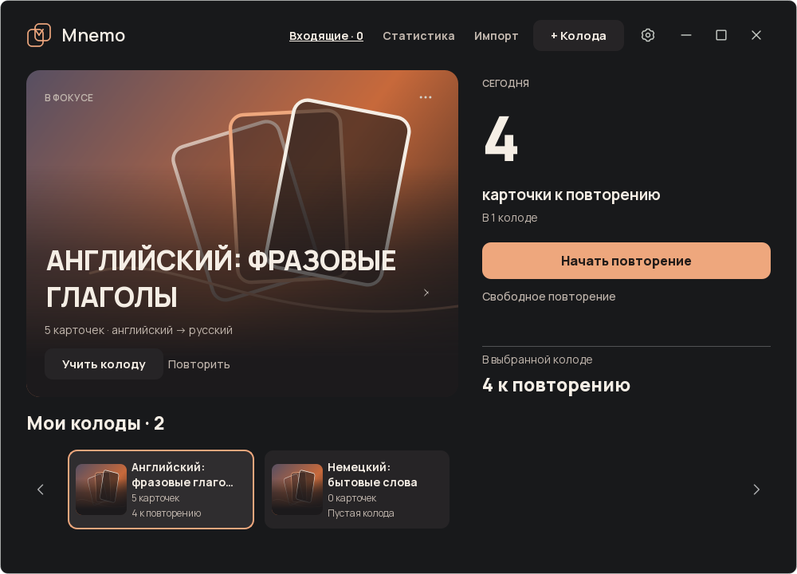
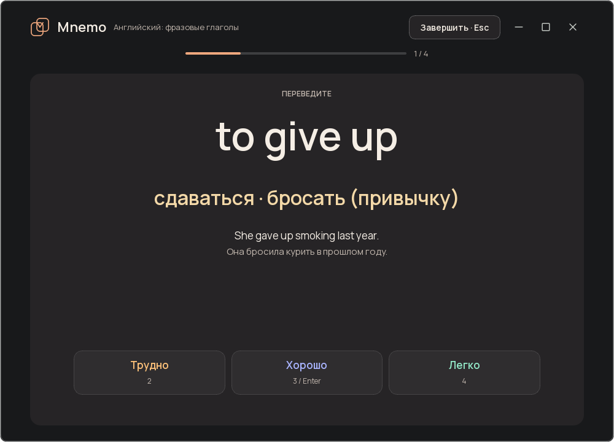

# Mnemo

Mnemo — приложение для Windows, в котором можно учить иностранные слова и фразы по карточкам. Колоды можно собрать вручную или импортировать из JSON. После каждого ответа Mnemo назначает следующий показ карточки с учётом оценки. Для свободной тренировки можно повторить целую колоду или случайную подборку. Такая тренировка не влияет на расписание.

Карточки и история повторений хранятся на компьютере в `%APPDATA%\Mnemo\mnemo.db`. Для занятий интернет не нужен.

## Запуск на Windows

Установите Python 3.11 или новее и откройте `start.bat` в папке проекта. При первом запуске скрипт создаст виртуальное окружение и установит PyQt6.

Те же шаги вручную в PowerShell.

```powershell
python -m venv .venv
.\.venv\Scripts\python.exe -m pip install -e .
.\.venv\Scripts\python.exe -m mnemo
```

## Как пользоваться

- **Повторение.** Введите перевод для проверки или откройте ответ и оцените себя. В карточку можно добавить примеры и подсказки.
- **Быстрый ввод.** По умолчанию `Ctrl+Alt+M` открывает форму с текстом из буфера обмена. Сохранённое слово попадёт во «Входящие». Там можно дописать перевод и выбрать колоду.
- **Импорт и экспорт.** Колоды можно сохранить в JSON и загрузить обратно. Поля и обработка дубликатов описаны в [спецификации формата](docs/specs/import-export.md).

## Тесты и сборка

После создания виртуального окружения выполните команды из папки проекта.

```powershell
.\.venv\Scripts\python.exe -m pip install -e ".[dev]"
.\.venv\Scripts\python.exe -m pytest
.\.venv\Scripts\python.exe -m PyInstaller --noconfirm --clean Mnemo.spec
```

Готовый файл находится по пути `dist\Mnemo\Mnemo.exe`. При переносе приложения копируйте всю папку `dist\Mnemo`.

## Скриншоты





Правила повторения, хранение данных и работа интерфейса описаны в [спецификации проекта](spec.md).
